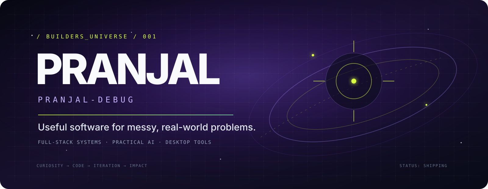
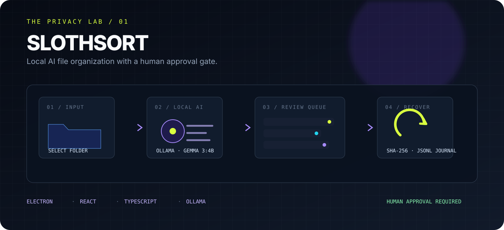
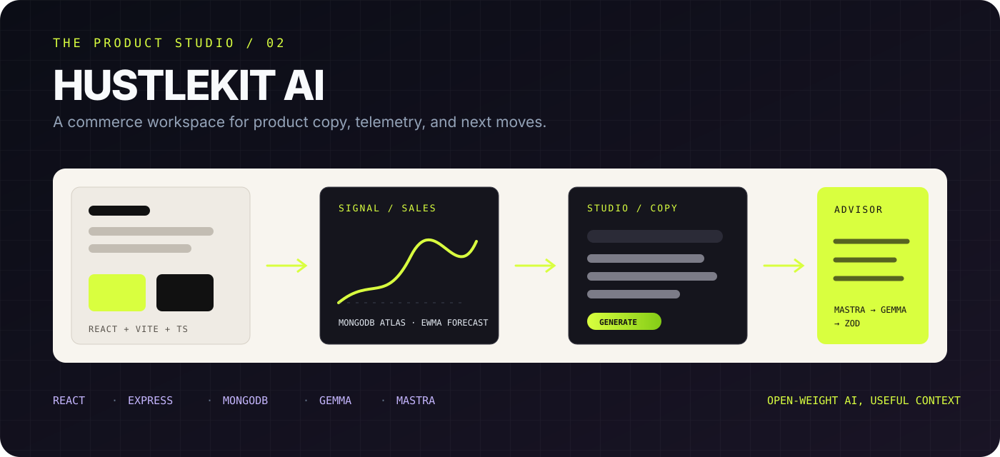
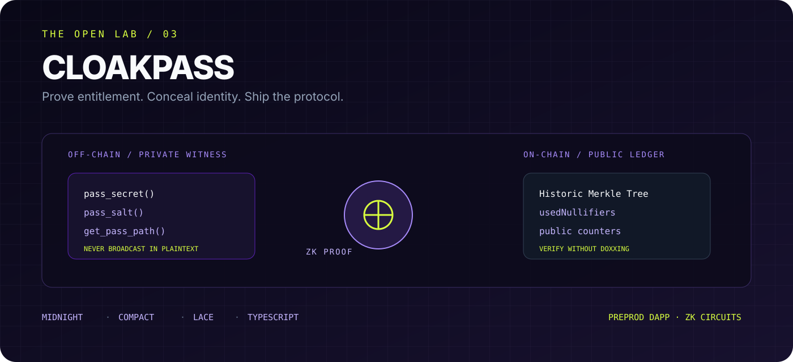
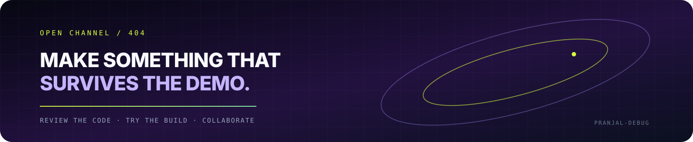

<!--
  PRANJAL-DEBUG | PROFILE README
  A small, hand-maintained map of the systems I am building and studying.
-->

<h1 align="center">PRANJAL-DEBUG</h1>

  

  <a href="#signal">SIGNAL</a>
  &nbsp;·&nbsp;
  <a href="#selected-builds">SELECTED BUILDS</a>
  &nbsp;·&nbsp;
  <a href="#technology-constellation">TECH CONSTELLATION</a>
  &nbsp;·&nbsp;
  <a href="#open-source-field-notes">OPEN SOURCE</a>
  &nbsp;·&nbsp;
  <a href="#collaborate">COLLABORATE</a>

  <code>FULL-STACK SYSTEMS</code> &nbsp; <code>PRACTICAL AI</code> &nbsp; <code>DESKTOP TOOLS</code>

## Signal

I’m **Pranjal Gupta** — a developer who likes turning ambiguous ideas into software that can survive contact with a real user.

I build across the browser, the backend, and the desktop: local-AI utilities, full-stack product experiments, and privacy-aware systems. I’m currently learning in public through shipped prototypes, careful documentation, and the uncomfortable parts of engineering — boundaries, failure modes, reproducibility, and making unfamiliar code understandable.

- **BUILDING** — products with a clear user loop, not just a clever demo.
- **EXPLORING** — local inference, privacy, ZK systems, and dependable workflows.
- **LOOKING FOR** — internships, open-source collaboration, and hard problems with kind teams.

> **Current lens:** useful software is a conversation between product intent and system constraints.

## Selected builds

The projects below are the clearest map of what I care about: privacy, practical AI, and systems that make a workflow feel lighter.

### 01 / THE PRIVACY LAB — [SlothSort](https://github.com/Pranjal-debug/slothsort)

**Stage:** released Windows x64 build · **v0.1.1**  
SlothSort is a Windows desktop app that scans a selected folder, asks a local Ollama model for organization proposals, and waits for a human decision before anything moves. The interesting part is the contract around the AI: bounded scan input, path validation, source fingerprints, collision checks, approval binding, and a JSONL journal for supported undo operations.

`Electron` · `React` · `TypeScript` · `Ollama` · `gemma3:4b`

**Open the work:** [source code](https://github.com/Pranjal-debug/slothsort) · [Windows release](https://github.com/Pranjal-debug/slothsort/releases/tag/v0.1.1) · [project README](https://github.com/Pranjal-debug/slothsort#readme)

  

  
<strong>Why this one matters</strong>

  The model is not the product by itself. The product is the reviewable workflow around it: inspect, edit, approve, execute, verify, and undo when integrity conditions still hold.

### 02 / THE PRODUCT STUDIO — [HustleKit AI](https://github.com/Pranjal-debug/hustlekit-ai)

**Stage:** deployed demo build  
HustleKit AI is a full-stack workspace for solo sellers: product copy generation, inventory and sales views, a forecast surface, and a multi-step Growth Advisor. It is a useful study in connecting a polished frontend to a typed API, persisted commerce data, provider-backed Gemma generation, and schema-validated recommendations without pretending demo data is production truth.

`React` · `Vite` · `TypeScript` · `Tailwind CSS` · `Node.js` · `Express` · `MongoDB Atlas` · `Mastra` · `Gemma 3 12B`

**Open the work:** [source code](https://github.com/Pranjal-debug/hustlekit-ai) · [try the live app](https://hustlekit-ai.onrender.com) · [deployment health](https://hustlekit-ai.onrender.com/healthz) · [project README](https://github.com/Pranjal-debug/hustlekit-ai#readme)

### 03 / THE OPEN LAB — [CloakPass](https://github.com/Pranjal-debug/CloakPass)

**Stage:** live Preprod prototype  
CloakPass is a Midnight Network dApp for proving access entitlement without revealing the ticket secret or the holder’s identity. Its architecture makes the privacy boundary explicit: private witnesses stay client-side, while commitments, nullifiers, and verification results become the narrow public surface.

`Midnight Compact` · `TypeScript` · `Vite` · `Lace Wallet` · `Historic Merkle Trees` · `ZK circuits`

**Open the work:** [source code](https://github.com/Pranjal-debug/CloakPass) · [live dApp](https://pranjal-debug.github.io/CloakPass/) · [Vercel mirror](https://cloak-pass.vercel.app/)

### Side quests worth opening

- **[QueueLess](https://github.com/Pranjal-debug/QueueLess)** — a Flutter + Serverpod digital queue system with customer tickets, staff controls, and concurrency-aware queue operations. [Open the app](https://queueless.serverpod.space/app) · [API health](https://queueless.api.serverpod.space/)
- **[AuraVote](https://github.com/Pranjal-debug/AuraVote)** — a Midnight experiment in anonymous ballots, verifiable tallies, and double-voting prevention.
- **[All repositories](https://github.com/Pranjal-debug?tab=repositories)** — the full archive, including earlier frontend experiments and learning projects.

## Technology constellation

No endless badge wall — just the tools that show up in the work.

- **FRONTEND** — shipping with `React` · `Vite` · `TypeScript` · `Tailwind CSS`; exploring `Flutter` · `Dart`.
- **BACKEND & DATA** — shipping with `Node.js` · `Express` · `MongoDB Atlas`; exploring `Serverpod`.
- **AI & PRIVACY** — shipping with `Ollama` · `Gemma` · approval-gated workflows; exploring `Mastra` · `Midnight Compact` · ZK circuits.
- **DESKTOP & DELIVERY** — shipping with `Electron` · `GitHub Actions` · `npm`; exploring cross-platform packaging and stronger release automation.

  
<strong>How I choose a tool</strong>

  I prefer a small, legible stack that makes the important boundary visible: React for fast product surfaces, TypeScript for shared contracts, Node/Express for typed APIs, Electron for desktop capabilities, and local or open-weight AI when the workflow benefits from keeping control close to the user.

## Open-source field notes

I’m still early in my open-source journey, so I’m not going to manufacture a contribution résumé. What I can show is the way I try to work:

- Read the unfamiliar codebase before proposing a change.
- Keep fixes focused, reproducible, and easy to review.
- Treat documentation as part of the interface.
- Test the boundary conditions, not only the happy path.
- Learn from maintainers, feedback, and the next bug the project reveals.

If you maintain a project involving developer tools, practical AI, privacy, or full-stack product engineering, I’d be glad to start with a small, useful issue.

## Live activity

GitHub itself is the live activity view. I’m intentionally skipping third-party stats cards here: they can fail, cache stale numbers, and turn a profile into a dashboard instead of a story.

  <a href="https://github.com/Pranjal-debug?tab=overview">VIEW PROFILE ACTIVITY</a>
  &nbsp;·&nbsp;
  <a href="https://github.com/Pranjal-debug?tab=repositories">BROWSE REPOSITORIES</a>
  &nbsp;·&nbsp;
  <a href="https://github.com/Pranjal-debug/Pranjal-debug/commits/main">READ THE README HISTORY</a>

## Collaborate

Have a rough idea, a stubborn bug, or a system that needs a second pair of eyes? I’m interested in projects where the code can teach us something and the result can help someone.

  

  <a href="https://github.com/Pranjal-debug">GitHub</a>
  &nbsp;·&nbsp;
  <a href="https://github.com/Pranjal-debug?tab=repositories">Projects</a>
  &nbsp;·&nbsp;
  <a href="https://github.com/Pranjal-debug/Pranjal-debug/issues">Start a conversation</a>

<code>Curiosity → Code → Iteration → Impact.</code>

